# EventTrust (TrustChain) — System Architecture (v2.5)

**Decentralized Multi-Modal Crisis Intelligence, Role-Based Emergency Response & Consensus Verification Platform**  
Combines Dual-Stream Artificial Intelligence (2D Convolutional Neural Networks for text + Google Gemini Multi-Modal Vision for imagery), Role-Based Operational Workflows (Field Volunteer vs Disaster Management Officer Command Center), Municipal Geospatial Partitioning (Zones 1–5 & Wards 1–25 with Interactive Leaflet Tactical Maps), Cross-Modal Consistency Verification, Spatio-Temporal Incident Clustering, and an Ethereum Multi-Witness Consensus Smart Contract with Hybrid Cloud Persistence (Supabase PostgreSQL + Storage).

---

## 1. High-Level Architecture Diagram

```mermaid
flowchart TD
    subgraph UI ["1. Presentation Layer & Role-Based Portals"]
        V1["Field Volunteer Dashboard (/VolunteerDashboard)"]
        V2["Quick Incident Reporter + GPS Grabber + Gemini Vision"]
        V3["Sector Hazard Map (Leaflet.js + Carto Dark)"]
        
        O1["Disaster Management Officer Command Center (/OfficerDashboard)"]
        O2["City-Wide Tactical Map (All 5 Zones & 25 Wards)"]
        O3["All-Incidents Operations Queue & Emergency Dispatch"]
        O4["Integrated Cryptographic Integrity Lab (/VerifyIntegrity)"]
    end

    subgraph DualAI ["2. Dual-Stream AI & Intelligence Layer (Django)"]
        B["Django 3.2 Backend Engine"]
        B1["NLP Stream: NLTK + TF-IDF (300D) + 2D CNN (Conv2D + MaxPool2D)"]
        B2["Vision Stream: Google Gemini 3.5 Flash Multi-Modal Vision API"]
        B3["Cross-Modal Consistency Engine (Discrepancy / Fake News Detection)"]
        B4["Spatio-Temporal Cluster Corroboration Engine"]
        B5["Composite Multi-Factor Explainable Trust Score (0-100)"]
    end

    subgraph Geo ["3. Municipal Spatial Services (Location Engine)"]
        G1["Zone & Ward Partitioning (Zones 1-5, Wards 1-25)"]
        G2["Coordinate Centroids & HTML5 Geolocation Resolver"]
        G3["Leaflet.js Vector Tiles & Pulsating Hazard Radar Markers"]
    end

    subgraph Cloud ["4. Hybrid Cloud Persistence Layer (Supabase)"]
        C1[("PostgreSQL DB: public.events")]
        C2[("PostgreSQL DB: public.users")]
        C3["Supabase Storage: 'event-images' Bucket"]
    end

    subgraph Blockchain ["5. Decentralized Blockchain Layer (Ethereum)"]
        D1["Web3.py RPC Gateway (Port 9545)"]
        D2["Event.sol Smart Contract (Solidity 0.8.11)"]
        D3["On-Chain Mapping: events[eventId]"]
        D4["Multi-Witness Consensus Voting Engine (Confirmations vs Disputes)"]
        D5["Cryptographic Hard-Gate SHA-256 Integrity Verifier"]
    end

    %% Volunteer Ingestion Flow
    V2 -->|"HTTP POST (Text + Field Photo + GPS Coords)"| B
    B --> B1 & B2
    B1 & B2 --> B3
    B --> B4
    B3 & B4 --> B5

    %% Cloud Storage Upload
    B -->|"Upload Photo via Service Role"| C3
    C3 -.->|"Public Image CDN URL"| B
    B -->|"Store Event Metadata + SHA-256 + Trust Score"| C1

    %% Blockchain Anchoring
    C1 -->|"Obtain Unique event_id"| B
    B -->|"recordEvent(eventId, sha256, trustScore)"| D1
    D1 --> D2 --> D3
    D2 -.->|"Transaction Hash Receipt"| B
    B -->|"Update blockchain_tx_hash"| C1

    %% Officer Operations
    B -->|"Enrich with Municipal Zones/Wards"| G1
    G1 --> G2 --> G3
    G3 --> V3 & O2
    C1 & D2 --> O3 & O4
```

---

## 2. Role-Based Architecture & Operational Workflows

### 2.1 Field Operations Volunteer (`/VolunteerDashboard`)
- **Target Persona**: Designated field volunteers assigned to municipal zones and wards (e.g. Zone 3 - South Education & Tech Hub / MBU Campus, Ward 14 - Sree Sainath Nagar).
- **Formal Business-Level Interface**: Clean, professional emergency services terminal.
- **Key Features**:
  1. **Sector Telemetry**: Live readout of assigned Zone, Ward, Operator ID, and GPS connectivity status.
  2. **Field Incident Reporting Terminal**:
     - Pre-configured disaster templates (Flash Flood, Structural Fire, Building Collapse, Hazardous Leak, Routine Normal).
     - **GPS Auto-Detect**: Uses HTML5 Geolocation API (`navigator.geolocation`) with one-click coordinate grabber and sector fallback.
     - **Photographic Asset Attachment**: Uploads eyewitness photos directly evaluated by Google Gemini Multi-Modal Vision.
  3. **Sector Hazard Map (Leaflet.js)**: Displays interactive dark map focused on the volunteer's assigned zone, showing local disaster pins with pulsating red radar rings.
  4. **My Sector Incident Log**: Real-time table of reports originating from this sector with trust scores and blockchain status.

### 2.2 Disaster Management Officer Command Center (`/OfficerDashboard`)
- **Target Persona**: Municipal Emergency Operations Center (EOC) Command Staff & Civil Defense Officers.
- **Executive Command Interface**: Tactical emergency command dashboard.
- **Key Features**:
  1. **City Threat Level Indicator**: Computes real-time threat rating (`CRITICAL THREAT`, `ELEVATED`, `STABLE`) based on active uncontained disasters.
  2. **City-Wide Master Tactical Map**:
     - Displays all 5 municipal zones across the Mohan Babu University and metropolitan corridor.
     - Interactive dropdown and filter pills: Filter by Zone, Disasters Only, Normal Events, or False Alarms.
     - Clickable marker popups with incident photo thumbnails, trust scores, and quick action buttons.
  3. **All-Incidents Operations Queue**: City-wide feed of all incoming volunteer reports, showing Zone, Ward, Volunteer ID, AI Classification, Confidence, Trust Score, Blockchain Status, and Multi-Witness Consensus.
  4. **Integrated Cryptographic Integrity Lab**:
     - Instant SHA-256 vs Ethereum on-chain audit form.
     - Interactive Demonstration Tools: One-click "Simulate Tamper" and "Restore Authentic Event" for presentation evaluation.
  5. **Emergency Response Dispatch Protocol**: One-click dispatch action alerting response units, medical teams, and civil defense to the pinpointed ward.

---

## 3. Municipal Spatial Partitioning (Zones & Wards)

| Zone Identifier | Zone Description | Center Coordinates | Assigned Wards | Color Theme |
| :--- | :--- | :--- | :--- | :--- |
| **Zone 1** | Central Commercial District | `13.6350, 79.4200` | Wards 01–05 (City Center, Market, Railway) | Cyan (`#38bdf8`) |
| **Zone 2** | North Industrial Corridor | `13.6550, 79.4300` | Wards 06–10 (Logistics, Tech Valley, Heavy Industry) | Amber (`#f59e0b`) |
| **Zone 3** | South Education & Tech (MBU Campus) | `13.6214, 79.2903` | Wards 11–15 (University, Nagapatla, Sree Sainath Nagar) | Emerald (`#10b981`) |
| **Zone 4** | East Residential Sector | `13.6250, 79.4450` | Wards 16–20 (Meadows, Lakefront, Sunrise Colony) | Violet (`#a855f7`) |
| **Zone 5** | West Riverfront & Heritage | `13.6150, 79.4000` | Wards 21–25 (Riverview, Bypass, Heritage Quarters) | Rose (`#ec4899`) |

---

## 4. Multi-Modal Vision & Trust Verification Pipeline

### 4.1 Google Gemini Multi-Modal Vision (`multimodal_vision.py`)
- Analyzes field eyewitness photos using Google Gemini Multi-Modal Vision API (`gemini-3.5-flash` model).
- Resolves visual feature cues (fire, smoke, floodwaters, debris) vs harmless objects (logos, campus presentations, anime art).
- Rejects fabricated alarms with **Media Mismatch Flags** and penalizes trust scores to 20/100.

### 4.2 Ethereum Smart Contract Anchoring (`Event.sol`)
- Smart contract deployed at `0xBbC4FE9a7b2a566C2601fF9740Cc69C6D98e026c` on Ethereum Devnet (`port 9545`).
- Computes canonical SHA-256 post digest following multi-modal fusion.
- Anchors cryptographic proof on-chain via `recordEvent(eventId, sha256_hash, trustScore)`.
- Decentralized multi-witness consensus voting via `castWitnessVote(eventId, confirmsDisaster)`.

---

## 5. Quick Role Access (Evaluator Demo Credentials)

| Role | Username | Password | Dashboard URL | Assigned Jurisdiction |
| :--- | :--- | :--- | :--- | :--- |
| **Field Operations Volunteer** | `volunteer1` | `pass123` | `http://127.0.0.1:8000/VolunteerDashboard` | Zone 3 (MBU Campus) &bull; Ward 14 |
| **Disaster Management Officer** | `officer_eoc` | `pass123` | `http://127.0.0.1:8000/OfficerDashboard` | All Zones &bull; City EOC HQ Command |

Operators can also register custom handles with specific Zone/Ward selections via `http://127.0.0.1:8000/Register.html`.
